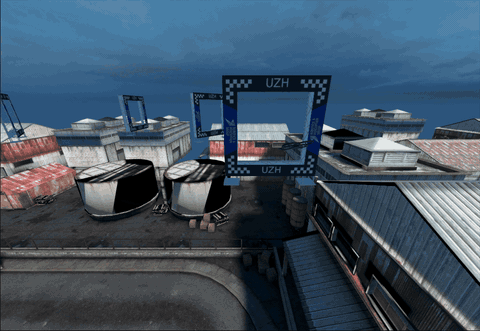
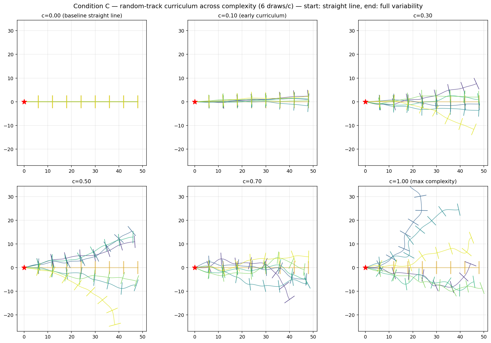

# Flightmare — Autonomous Drone Racing (IROS 2021 Replication)

**Cornell Physical Intelligence** · Drone Racing RL Research

[](LICENSE)

> Replicating and extending [Autonomous Drone Racing with Deep Reinforcement Learning (IROS 2021)](https://rpg.ifi.uzh.ch/docs/IROS21_Yunlong.pdf) using [Flightmare](https://github.com/uzh-rpg/flightmare) + Stable-Baselines3 PPO.

---

## Overview

This is a fork of [uzh-rpg/flightmare](https://github.com/uzh-rpg/flightmare) that faithfully replicates the IROS 2021 autonomous drone racing baseline (Song et al.), then uses it to study curriculum learning for PPO drone racing.

---

## Results



**[Project video (YouTube)](https://youtu.be/M0WbGkZZK00)**: a short walkthrough of the replication, the curriculum experiment, and the results.

This codebase was then used as the testbed for an **automated curriculum learning** experiment: under a matched 100M-step budget and locked PPO hyperparameters, it compares no curriculum, a hand-designed track ladder, and an adaptive procedural curriculum that raises track complexity as the policy improves. The hand-designed ladder generalizes best to closed-loop named tracks, the adaptive curriculum generalizes best to unseen procedural tracks, and no curriculum reaches 4/8 gates on the target but generalizes to nothing. Plan and analysis are in [notes/experiment-plan.md](notes/experiment-plan.md).

**circle_8 solved (8/8 gates, deterministic full lap) by two recipes:**

- **Recipe A, hand-tuned curriculum.** `straight_2 → straight_3 → bent_3_15 → bent_3_30 → circle_8`, each rung fine-tuned from the previous rung's best model with an entropy-compression chain (0.003 → 0.0003 → 0.0001 → 0.00005), about 230M steps total. See [notes/track-curriculum-plan.md](notes/track-curriculum-plan.md) and [notes/curriculum-log.md](notes/curriculum-log.md).
- **Recipe B, sweep-derived.** An Optuna TPE sweep over 11 PPO hyperparameters found `lr=3e-4, ent=0.05, clip=0.3, n_steps=500, n_epochs=10` as the best fine-tune from `bent_3_30`; a single 50M-step run with those settings clears the track with no further curriculum. See [notes/sweep-results.md](notes/sweep-results.md).

The curriculum study also located where the from-scratch policy breaks: it learns transient bends of 15° per gate but plateaus at 2/3 gates once bends reach 30°. Sustained turning is what the curriculum has to teach.

Track previews for every rung are in `flightrl/training/track_previews/`; procedurally generated tracks at increasing complexity are in `flightrl/training/experiment/track_previews_random/`.



---

## Project Structure

```
flightmare/
├── flightlib/                              # C++ physics engine → compiled into flightgym.so
│   ├── src/envs/quadrotor_env/
│   │   └── quadrotor_env.cpp               # IROS 2021 env (26-dim obs, spherical gates)
│   ├── include/flightlib/envs/quadrotor_env/
│   │   └── quadrotor_env.hpp               # Header with obs space enums + TrajectorySnapshot
│   ├── src/common/
│   │   └── command.cpp                     # -Ofast NaN fix (volatile-based)
│   └── configs/
│       ├── quadrotor_env.yaml              # Split-S track (7 gates, quaternion rotations)
│       └── vec_env.yaml                    # 100 envs, no render
│
├── flightrl/training/                      # Python training + evaluation scripts
│   ├── gate_racing_iros.py                 # Main training script (PPO + VecNormalize)
│   ├── sb3_vec_env.py                      # SB3 VecEnv wrapper for flightgym
│   ├── run_ablation.py                     # Ablation study runner
│   ├── sb3_vec_env_ablation.py             # Ablation-aware VecEnv wrapper
│   ├── visualize_policy.py                 # Trajectory recording + plotting + GIF
│   ├── reward_probe.py                     # Reward signal diagnostic tool
│   └── verify_reward.py                    # Reward calculation verification
│
├── notes/                                  # Experiment plan, curriculum log, sweep results, debugging log
├── docs/unity-demo.md                      # Live Unity render of a trained policy
├── CONTRIBUTING.md                         # How to contribute
└── README.md                               # This file
```

---

## Quick Start

### Prerequisites

- Ubuntu 20.04+ (tested on 24.04 ARM64)
- [Miniforge](https://github.com/conda-forge/miniforge) or Anaconda
- CMake 3.16+, GCC/G++ with C++17 support

### 1. Clone & Setup Conda Environment

```bash
git clone https://github.com/ShauryaSen/flightmare-vm.git
cd flightmare-vm
export FLIGHTMARE_PATH=$(pwd)

conda create -n flightmare python=3.8 -y
conda activate flightmare
pip install stable-baselines3[extra] torch numpy matplotlib ruamel.yaml pyyaml
```

### 2. Build the C++ Physics Engine

```bash
cd flightlib
pip install .
# or for development:
python setup.py build_ext --inplace
```

### 3. Train

```bash
cd flightrl/training
python gate_racing_iros.py --train 1 --total-timesteps 25000000
```

### 4. Evaluate

```bash
python gate_racing_iros.py --train 0 \
  --model-path saved/best_iros_gate_racing/best_model.zip \
  --vecnorm-path saved/best_iros_gate_racing/vec_normalize.pkl
```

### 5. Visualize

```bash
python visualize_policy.py \
  --model saved/best_iros_gate_racing/best_model.zip \
  -n 30 --animate --animate-n 3
```

---

## Environment Specification (IROS 2021)

### Observation Space (26-dim)

| Component | Dims | Description |
|-----------|------|-------------|
| Linear velocity | 3 | `v_WB` in world frame |
| Linear acceleration | 3 | `v̇_WB` via finite difference |
| Rotation matrix | 9 | Flattened 3×3 `R_WB` (no gimbal lock) |
| Angular velocity | 3 | `ω_B` in body frame |
| Gate 1 (next) | 4 | Spherical `(r, θ, φ, α)` in body frame |
| Gate 2 (future) | 4 | Spherical `(r, θ, φ, α)` in gate 1's frame |

**Key design:** No absolute position (position-invariant policy), rotation matrix instead of Euler angles, spherical gate coordinates.

### Action Space (4-dim)

Per-motor normalized thrusts `[T1, T2, T3, T4]`.

### Reward Function

```
r(t) = progress + gate_bonus + survival - control_penalty - body_rate_penalty
```

---

## Contributing

See [CONTRIBUTING.md](CONTRIBUTING.md) for setup instructions and contribution guidelines.

---

## Citations

If you use this code, please cite:

```bibtex
@inproceedings{song2021autonomous,
    title={Autonomous Drone Racing with Deep Reinforcement Learning},
    author={Song, Yunlong and Scaramuzza, Davide},
    booktitle={IEEE/RSJ International Conference on Intelligent Robots and Systems (IROS)},
    year={2021}
}

@inproceedings{song2020flightmare,
    title={Flightmare: A Flexible Quadrotor Simulator},
    author={Song, Yunlong and Naji, Selim and Kaufmann, Elia and Loquercio, Antonio and Scaramuzza, Davide},
    booktitle={Conference on Robot Learning},
    year={2020}
}
```

## License

This project is released under the [MIT License](LICENSE).
